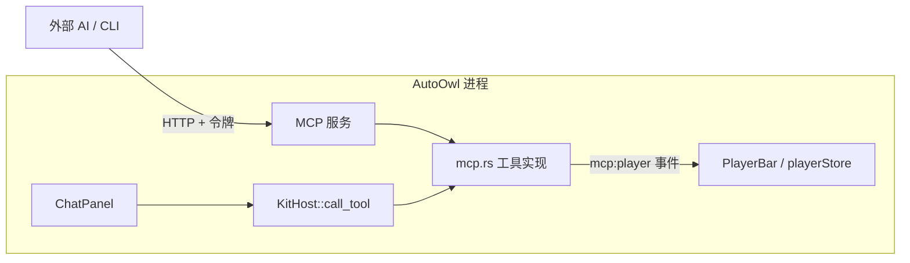

# AI 对话设计

> 状态：已实施（Aether `d7391853`，CI 绿）。验收结果见 §6。

## 1. 目标

在 AutoOwl 内增加 AI 对话。用户说「放一首千千阙歌」，模型调用工具搜索并播放，歌在应用里响。

非目标：图片生成、联网搜索、Skills、MCP 客户端、模型预设。需要时再开对应 feature。

## 2. 方案

用 Aether 的对话能力：后端开 `tauri-plugin-aether` 的 `providers` + `chat` feature，宿主实现 `KitHost`；前端用 `ChatPanel` 和 `ProvidersSettings`。

应用内对话**直接调用宿主工具，不经过 MCP**。MCP 服务继续给外部 AI（Claude、Cursor、`autoowl-cli`）用。

不让应用内对话走 MCP 客户端连自己的原因：要额外持有令牌、走一次本机 HTTP，而且 MCP 服务没启动时对话就用不了，换来的只是多一层转发。

## 3. 工具

两个入口共用 `interface/mcp.rs` 里的同一张工具表和同一个执行函数，不复制实现：

| 工具 | 作用 | MCP 作用域 | 对话审批 |
|---|---|---|---|
| `search_songs` | 全源搜索，返回最多 10 条带 `index` 的结果 | `music.read` | 自动 |
| `player_status` | 当前歌曲、状态、队列长度 | `music.read` | 自动 |
| `play_song` | 按上次搜索的 `index` 播放 | `music.control` | 自动 |
| `pause` / `resume` / `next` / `previous` | 播放控制 | `music.control` | 自动 |

审批全部设为 `Auto`：这些操作都可随手撤回，逐次弹确认会打断「帮我放首歌」的体验。要改成播放前确认，把对应工具的 `Approval::Auto` 改为 `Ask` 即可。

播放类工具仍发 `mcp:player` 事件，由 `PlayerBar` 走与点击相同的 `playerStore`。全应用只有一个播放器。

系统提示词告诉模型：它是音乐助手；先 `search_songs` 再按 `index` 调 `play_song`；用中文简短回复。

## 4. 改动

| 位置 | 改动 |
|---|---|
| `Cargo.toml` / `package.json` | Aether 升到 `d739185`；插件加 `providers`、`chat` feature |
| `interface/mcp.rs` | 工具表改为一份目录；MCP 的 `ExposedTool` 和对话的 `HostTool` 都由它生成；`call_tool` 分发到同一个执行函数 |
| `lib.rs` | `AutoOwlHost` 实现 `tools` / `call_tool` / `system_prompt`；注册 `.providers(providers.db)`、`.chat(默认配置, chat.db)` |
| `capabilities/default.json` | 加 `aether:providers`、`aether:chat`、`aether:chat-history` |
| `+layout.svelte` | `createTauriPorts` 打开 `providers`、`chat`、`chatHistory` |
| 新页面 `/chat` | 「AI 对话」，放 `ChatPanel`；导航放在音乐区。挂载前先取默认模型传给 `model` |
| `/settings/ai` | 增加「模型服务」区（`ProvidersSettings` + 三个预设），原 MCP 设置保留在下方 |

### 4.1 默认模型

`ChatPanel` 只在挂载时读一次 `model`，宿主不传就一直为空，发送按钮禁用，用户每次进来都得重选。

参考 AutoNote（`refactor/use-aether` 分支：`select_model` 优先用请求里的模型，否则回退到「对话」角色绑定的模型）。AutoOwl 不做单独的角色设置页，**用过的模型就是默认模型**：

- `select_model`：依次取请求里的模型、上次用过的模型、第一个可用的对话模型，每一项都必须仍在当前可用列表里（已删除或停用的跳过）。选中后写入 `app_settings` 的 `chat.model`。
- 新命令 `chat_default_model`：按同样规则返回 `ChatPanel` 的初始模型；没有可用模型时返回 `null`，面板引导去设置。
- 「可用」指类型为对话、且未明确标记为不支持工具调用的模型：不能调工具的模型放不了歌。

### 4.2 预设服务商

用 Aether 的共享预设 `@ouraihub/aether-presets` 中的 `CHINA_PROVIDER_PRESETS`：七牛云、硅基流动、Fenno。由 `ProvidersSettings` 首次打开时写入一次，默认停用、没有 Key，用户填 Key 并启用即可。预设随 Aether 版本更新，AutoOwl 不另存一份。

数据：`providers.db`（模型服务与 API Key，Key 由 Aether 用 DPAPI 加密）、`chat.db`（会话历史），都在数据目录下，与 `mcp-server.db` 同级。

## 5. 前提与安全

- 用户必须在「模型服务」里配置一个可用的模型和 API Key（DeepSeek、OpenAI 或兼容接口）。没配时 `ChatPanel` 引导去设置页。
- API Key 只存在 Rust 侧并加密落盘；模型请求由 Rust（reqwest）发出，不经过 WebView，CSP 不需要放宽。
- 工具结果是应用自己的数据，不属于外部内容。模型能做的事仅限上表 7 个工具，没有文件、网络或下载权限。

## 6. 验收

原计划在没有 API Key 时用本地模拟模型跑通全链路。实施时已有真实模型可用，直接用它验收，模拟服务没有被调用，测完已删除。

实测（模型 `claude-sonnet-5-5`，问「播放千千阙歌」）：

- 对话界面显示两次工具调用：`search_songs` 返回 10 条结果，`play_song` 播放第一条（fivesing · Sax韩）。
- 模型回复说明了在放哪个版本，并提示结果里没有陈慧娴原版。
- 日志：`chat.run.finished status=Completed rounds=3 tools=2`。
- `<audio>` 在播（kugou CDN，已推进到 59 秒，无错误）。

门禁全部通过：`pnpm check` 0 错误、`pnpm test` 15 个、`cargo fmt`、`clippy -D warnings`、`cargo test` 322 + 2 个、`build-app.bat`。

### 6.1 默认模型与预设（独立数据目录的沙盒实例 + 本地模拟模型）

- 全新数据目录打开「AI 接入」：写入七牛云、硅基流动、Fenno 三条，均为停用、无 Key；此时 `chat_default_model` 为 `null`。
- 加一个支持工具的模型后进入「AI 对话」：面板已选中该模型，不碰模型选择直接发送，模拟模型收到三轮请求（`search_songs` → `play_song` → 回复）。
- 手动切到第二个模型发一次，离开再回来：面板仍是第二个模型，`chat_default_model` 也返回它。
- 单测 `chat_model_precedence_skips_models_that_are_gone` 固定选择顺序和「已删除模型被跳过」。`cargo test` 323 + 2 个。

## 7. 风险

- 包体：release 从 25.5 MB 增加到 28.6 MB（+3.1 MB），来自 `aether-chat`、`aether-providers`。
- 搜索结果按全局「上次搜索」记录：对话和外部 AI 同时操作会互相覆盖（`mcp.rs` 已标注 `ponytail:`）。单用户桌面应用可接受。
